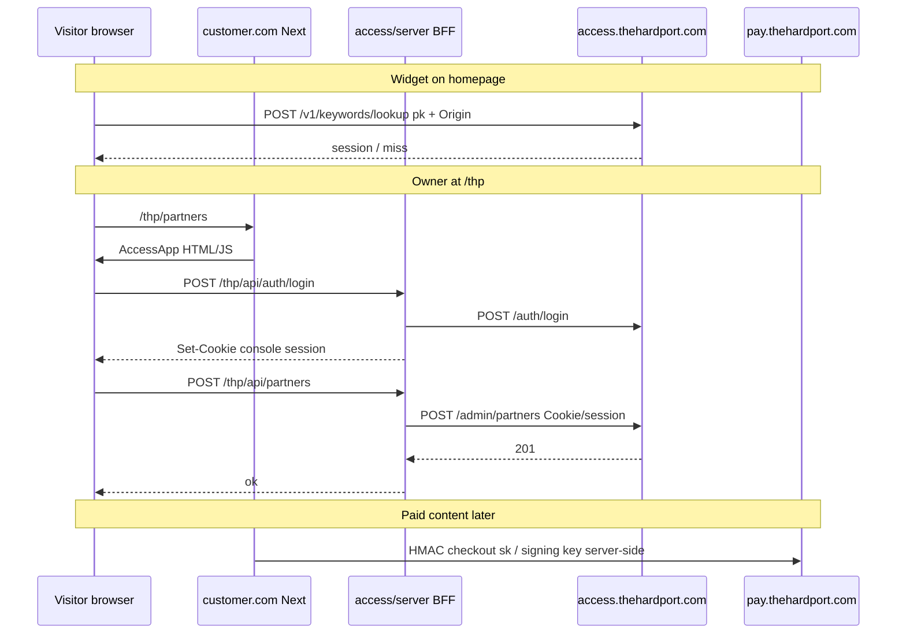

# Access — installation from an external site & UI vs server separation

Read this **before** building or deploying the Access service and the npm **`access`** console package.

**Related:** [`platform-routes.md`](platform-routes.md) (credentials), [`website-sitemap.md`](website-sitemap.md) (routes), [`hardport-architecture.md`](hardport-architecture.md) (platform DB).

---

## 1. Three layers (who runs what)

| Layer | Who operates it | What it is | Customer touches it? |
|-------|-----------------|------------|----------------------|
| **A. Platform backend** | **You (THP)** — hosted online | `@hardport/access` (:4001), `@hardport/payments` (:4002), platform Postgres | No deploy — they **point env at your URL** |
| **B. Installable UI + BFF** | **Customer** (or THP on thehardport.com) | npm package **`access`** — React console + Next route handlers | `pnpm add access`, mount `/thp`, set env |
| **C. Customer website** | **Customer** | Their Next/Vercel/Dokploy app, their domain, their marketing pages | They own deploy |

**External installation** means: customer adds **`access`** to **their** repo (layer B). They do **not** install layer A. Layer A is your multi-tenant SaaS (same Access cluster for many tenants).

```text
                    ┌─────────────────────────────────────┐
                    │  THP cloud (you deploy once)         │
                    │  access.thehardport.com  :4001       │
                    │  pay.thehardport.com     :4002       │
                    │  platform Postgres (tenants…)        │
                    └──────────────▲──────────────────────┘
                                   │ HTTPS only
         ┌─────────────────────────┼─────────────────────────┐
         │                         │                         │
   customer.com              thehardport.com            other-tenant.com
   npm `access`              npm `access`               npm `access`
   env: pk, sk, URL          env: pk, sk, URL           env: pk, sk, URL
```

---

## 2. What “install from npm” actually means

Customer (or you on THP) does **four** things:

1. **Provision tenant (once)** — you run bootstrap / Tipper → tenant slug, owner staff user, **`pk` + `sk`** tied to their **origin** (`https://customer.com`).
2. **Add dependency** — `pnpm add access` (name TBD on npm registry).
3. **Set environment variables** on **their** hosting (Vercel, Dokploy, etc.) — see §4.
4. **Mount integration points** in **their** Next app (see also **`packages/access-ui/README.md`**).

**Do not** add TypeScript `paths` aliases to the package source when installing from npm. Node resolves subpaths from `"exports"` in the package. In this monorepo, `pnpm add @psyferblock/access workspace:*` is enough; only set `transpilePackages: ['@psyferblock/access']` in `next.config`.

```tsx
// app/thp/[[...slug]]/page.tsx  — THP Access console (platform staff: owner / admin / staff)
import { AccessApp } from '@psyferblock/access'

export default function Page() {
  return <AccessApp basePath="/thp" />
}
```

```ts
// app/thp/api/[[...path]]/route.ts  — BFF (server only)
export { GET, POST, PATCH } from '@psyferblock/access/server'
```

Public catalog + product pages (optional on the marketing site):

```tsx
import { CatalogGrid, ProductPage } from '@psyferblock/access/widgets'
import { fetchCatalog, fetchContentForPage } from '@psyferblock/access/server'
```

**Website admin** (intake reviewers on `/sign-in` → `/review`) is **not** this package; it uses your Nest `apps/api` OAuth JWT. **THP Access** is a separate login at **`/thp/login`**. Header shortcuts should expose both when the respective sessions exist.

No Docker image of Access on the customer side. No platform DB connection string on the customer side.

---

## 3. Separating the npm package: client vs server

The **`access`** package must ship as **two entry points** so secrets stay off the client bundle.

| Export path | Runs where | Contains | Must NOT contain |
|-------------|------------|----------|------------------|
| **`access`** (default) | Browser + RSC shell | `AccessApp`, internal router, forms, partner OTP **UI**, widgets | `sk`, staff passwords, HMAC signing keys, raw Access session replay |
| **`access/server`** | **Node only** (Next Route Handlers, Server Actions) | BFF: login proxy, admin API proxy, OTP send/verify, connection test, checkout sign | React DOM (keep lean) |
| **`access/widgets`** (optional) | Browser | Public `pk` only — keyword lookup, teaser | `sk`, admin calls |

**Rule:** Any call that uses **`sk`**, **staff session**, **internal HMAC**, or **sends email OTP** goes through **`/thp/api/*`** → `access/server` → your hosted Access/Payments.

**Rule:** Browser may only call:

- Your **same-origin** `/thp/api/...` (BFF), or
- Hosted Access **`/v1/*`** with **`pk`** + browser **`Origin`** (widgets).

Build tooling: mark `access/server` as `server-only` / separate export in `package.json` `"exports"` so bundlers fail if imported from `'use client'`.

---

## 4. Environment variables (customer deploy)

Split **public (browser-safe)** vs **server-only**.

### 4.1 Required for console + widgets

| Variable | Client? | Purpose |
|----------|---------|---------|
| `HP_ACCESS_URL` | Server (BFF reads) | Base URL of **your** Access API, e.g. `https://access.thehardport.com` |
| `NEXT_PUBLIC_HP_PUBLIC_KEY` | **Yes** | `pk…` — widgets + optional client-side public reads |
| `HP_SECRET_KEY` | **Server only** | `sk…` — BFF entitlement checks, connection verify, server-side content |
| `HP_TENANT_SLUG` | Server (optional v1) | If one deploy = one tenant; BFF sends on login if needed |

### 4.2 Later (checkout from customer server)

| Variable | Client? | Purpose |
|----------|---------|---------|
| `HP_PAYMENTS_URL` | Server | Payments API base |
| `HP_INTERNAL_SIGNING_KEY` | **Server only** | HMAC for `POST /internal/checkout-sessions` (+ complete) |

Customer **never** gets platform DB `DATABASE_URL`, `FIELD_KEYS`, or other tenants’ keys.

### 4.3 What you set on **hosted** Access (THP ops)

| Variable | Purpose |
|----------|---------|
| `DATABASE_URL` | Platform Postgres, role `hp_access` |
| `ADMIN_ORIGINS` | Origins allowed for direct Access login (if used); BFF-heavy setups may narrow this |
| `FIELD_KEYS`, signing keys, etc. | See service config |

When onboarding a site, **`POST /admin/sites`** (or bootstrap) registers **`allowed_origins`** for their **`pk`** (must include `https://customer.com`).

---

## 5. Credentials map (online behavior)

Four credential types on the platform — [full table in `platform-routes.md`](platform-routes.md). For **external install**, map them like this:

| Credential | Where it lives after install | Used by |
|------------|------------------------------|---------|
| **`pk`** | `NEXT_PUBLIC_*` on customer host | Browser widgets; Access checks `Origin` |
| **`sk`** | Server env on customer host | `access/server` BFF only |
| **Staff / partner session** | HttpOnly cookie on **customer.com** (issued by BFF after login/OTP) | Browser → `/thp/api/*` only |
| **Internal HMAC** | THP or customer server env (checkout) | Payments internal routes |

**Staff login flow (console):**

```text
Browser  POST customer.com/thp/api/auth/login  { email, password, totp }
    →  access/server  POST HP_ACCESS_URL/auth/login  (server-side)
    →  access/server  stores sealed session  Set-Cookie on customer.com
Browser  GET customer.com/thp/api/partners
    →  access/server  replays session  GET HP_ACCESS_URL/admin/partners
```

Partner OTP: same pattern — `/thp/api/partner/*` on customer origin, email sent from BFF or Access (design choice when building service).

---

## 6. Online production diagram (external customer)



---

## 7. Onboarding conversation checklist (you ↔ customer)

Use this when selling or hand-holding an external install:

1. **Tenant** — What slug, owner email, commission defaults?
2. **Domain** — Production origin(s) for `pk` allow-list (`https://www` vs apex).
3. **Keys** — Generate site in Access; deliver **`pk`** + **`sk`** once (secure channel for `sk`).
4. **Host** — Next  App Router? Can they add `app/thp/[[...slug]]` + `app/thp/api/[...path]`?
5. **Env** — They paste vars in Vercel/Dokploy; rebuild if `NEXT_PUBLIC_*` changes.
6. **Verify** — `/thp/connection` “test” hits health + optional lookup.
7. **Staff** — Owner uses `/thp/login` (not Google OAuth on `/sign-in` unless they are THP intake ops on thehardport.com).
8. **Partners** — Created in `/thp/partners`; partners use `/thp/partner` OTP.
9. **Support boundary** — UI bugs → `access` package version; data/commissions → platform; their site CSS around widgets → them.

---

## 8. THP (thehardport.com) vs external customer

| Concern | thehardport.com | External customer |
|---------|-----------------|-------------------|
| Platform Access URL | Same hosted API | Same hosted API |
| npm `access` mount | `/thp/*` | `/thp/*` (or `basePath` they choose) |
| `/review` intake | **Yes** — `apps/api` | **No** (unless they also run your Nest stack) |
| OAuth `/sign-in` | THP operators | Not required for Access |
| Who creates tenant | You (bootstrap) | You (Tipper/bootstrap) |

Same **`access`** package; different surrounding app (THP has extra consulting routes).

---

## 9. Versioning & updates

| Piece | Update mechanism |
|-------|------------------|
| **`access` npm** | Customer `pnpm update access` — UI + BFF handlers |
| **Access API** | You deploy `@hardport/access` — backward-compatible API versioning or coordinated releases |
| **Keys rotation** | New `pk`/`sk` in Access admin → customer updates env → redeploy |

Document breaking changes in `access` changelog; keep BFF paths stable (`/thp/api/...`) where possible.

---

## 10. Build order (aligned with your plan)

1. **Hosted Access service** complete (admin routes, partner email, partner OTP API, CORS/origin rules for `pk`).
2. **`access/server`** BFF contract frozen (login, partners, connection verify).
3. **`access`** UI (`AccessApp`) against BFF only — no direct admin calls from browser.
4. Deploy Access + Payments to staging URL; dogfood from `apps/web`.
5. Document customer install (this file + short README in package).
6. Production deploy test with one external-origin allow-list entry.

---

## 11. Locked decisions (product)

### BFF — who “owns” it?

| | |
|--|--|
| **We (Psyferblock)** | Write, version, and publish the BFF as part of the npm package (`access/server`). Behavior, security fixes, and API shape are our responsibility. |
| **Customer** | Hosts execution only: their Next deploy runs our route handlers (mount `app/thp/api/[...path]`). They do **not** fork or maintain BFF logic unless they choose to override (unsupported). |

So: **managed by us in code**, **runs on their server** — same as installing `@sentry/nextjs` or Stripe’s server helpers.

### Email (partner OTP, alerts)

**We send.** Mail goes out from **Psyferblock / THP infrastructure** (e.g. Resend on Access service or a small mailer we operate), with **our domain signature** (`psyferblock.io` / agreed from-address). Customer sites do **not** plug in their own Resend for platform OTP.

Flow: UI → customer `/thp/api/partner/request-otp` (our BFF) → **hosted Access** (or our API) → email with Psyferblock signature.

### Console session

**Browser session only** — when the **tab/window session ends**, the operator must sign in again.

Implementation target: **session cookie** (no long `Max-Age` / no persistent “remember me”) or sealed session tied to browser session; BFF clears on logout. Not 7-day JWT in `localStorage`.

### npm package

Publish under company scope, e.g. **`@psyferblock/access`** (console UI + `access/server` BFF).  
Company site: **psyferblock.io**.  
Monorepo path can stay `packages/access-ui` until publish; document the scoped name in README.

Platform API in this repo remains **`@hardport/access`** (private service) — different artifact from the installable **`@psyferblock/access`** client package.

---

## 12. Still open when building service

| # | Question | Notes |
|---|----------|--------|
| 1 | `ADMIN_ORIGINS` | Prefer BFF-only: customers never POST login directly to Access from browser |
| 2 | Exact from-address | e.g. `access@psyferblock.io` vs `noreply@thehardport.com` for OTP |

---

*Install UI via `@psyferblock/access`; platform API hosted by THP; BFF shipped by us, runs on customer host; mail from us; console session ends with tab.*
