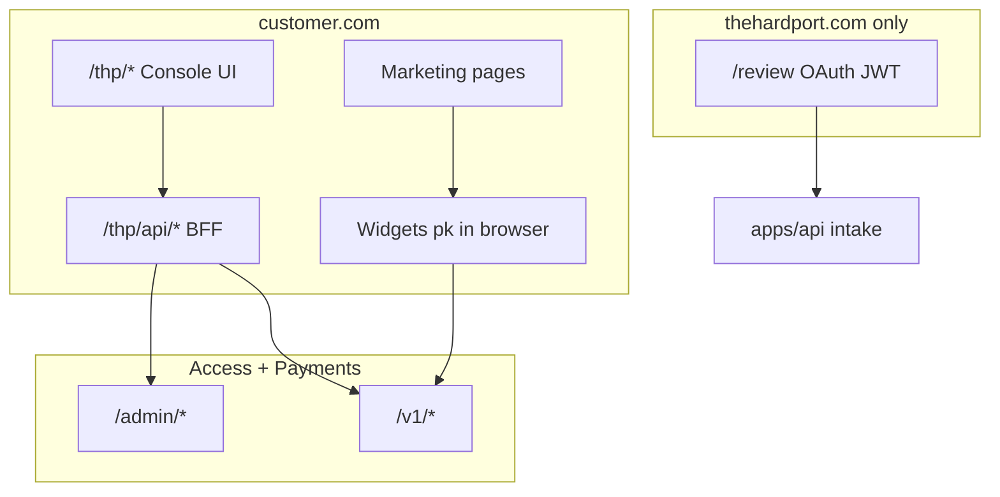

# THP access & sign-in — integration roadmap

**Purpose:** One place to finalize how you sign in, how **Access** (and related services) connect to **thehardport.com** and other sites, what UI to reuse, which databases hold what, and how to deploy it.

**Status:** planning — pick phases at the bottom and check items off as you ship.

**Related docs**


| Doc                                                                                                                                               | What it covers                                      |
| ------------------------------------------------------------------------------------------------------------------------------------------------- | --------------------------------------------------- |
| `[apps/api/AUTH_SETUP.md](../apps/api/AUTH_SETUP.md)`                                                                                             | Website operator OAuth (Google/Meta) + JWT          |
| `[docs/hardport-architecture.md](hardport-architecture.md)`                                                                                       | Access + Payments platform design                   |
| `[docs/platform-routes.md](platform-routes.md)`                                                                                                   | HTTP routes, API keys, staff cookies                |
| `[DOCKER.md](../DOCKER.md)`                                                                                                                       | Web + API containers                                |
| `[the-hard-port-os/operations/launch-scaffold/P01-production-deploy.md](../the-hard-port-os/operations/launch-scaffold/P01-production-deploy.md)` | Production env checklist                            |
| `[website-sitemap.md](website-sitemap.md)`                                                                                                        | **Confirmed** public vs `/review` vs `/thp/`* pages |
| `[services/access/README.md](../services/access/README.md)`                                                                                       | Access API vs `access` npm UI                       |
| `[access-installation-and-separation.md](access-installation-and-separation.md)`                                                                  | External npm install, env, client vs server exports |


---

## 1. Target product model — three audiences (yes, but not “one OAuth, three levels”)

You’re describing the right **commercial shape**. The nuance is **how each audience authenticates** and **what they’re allowed to see**.


| Audience    | Who                                      | Signs in?                                    | What they get                                                                                                | What they must *not* get                                                |
| ----------- | ---------------------------------------- | -------------------------------------------- | ------------------------------------------------------------------------------------------------------------ | ----------------------------------------------------------------------- |
| **Visitor** | Public, applicants, buyers               | Usually **no** account on the marketing site | Pages, `/apply`, keyword unlocks, paid content **after** entitlement                                         | Operator tools, partner stats, PII of other people                      |
| **Partner** | Creators/affiliates with a code/campaign | **Yes** — partner portal                     | Their campaigns, aggregate stats (lookups, matched keywords), **their** commissions                          | Other partners’ data, customer emails, full admin edit, intake review   |
| **Admin**   | THP owner/staff                          | **Yes** — staff login                        | Full tenant: content, keywords, grants, sites, partners, orders/commissions (staff), intake review (website) | Nothing blocked within tenant (owner/admin); staff may be limited later |


**Important corrections to the mental model**

1. **Visitors are not “OAuth users.”** Most never sign in. “Access different things” for a visitor means **entitlements** (keyword session, paid unlock, future course grant) — checked per slug, not a global “user dashboard.”
2. **Partners are not reviewers.** Partner value is **attribution** (someone used *their* word/code) → stats + commission. That data lives in the **platform DB** (`access.events`, `access.campaigns`, `payments.commissions`), with RLS so partners never see other partners’ rows or buyer emails.
3. **Admin is two layers in code today**, not one button:
  - **Website** `admin` — intake, funnel, future course grants (`apps/api` JWT).
  - **Platform owner/admin/staff** — catalogue, keywords, partners, manual grants (`services/access` + Payments cookie session).
   You want **full disclosure** → platform **owner/admin** (+ website `admin` for applications). `reviewer` on the website is a narrower role: review applications, not edit the whole platform.

**Prod auth should not be “everyone uses Google OAuth and we pick a level.”** Safer target:

```
/sign-in          → THP operators only (OAuth → JWT) → /review
/partnership      → partner portal (email + invite code → email OTP → session) → /partner
(public)          → no sign-in; entitlements via Access public API + grants
/admin or app     → THP staff full panel (Access staff session; TOTP for owner/admin)
```

**OAuth’s job in prod (near term):** let **your team** (and allowlisted operators) into **intake review**, not let every partner hit the same `/sign-in` and hope role assignment works.

**Partner page (to build):** Next routes e.g. `/partnership` (entry) and `/partner` (dashboard after OTP). Dashboard calls Access `GET /partner/campaigns`, `GET /partner/stats`, and Payments `GET /partner/commissions` with a **short-lived partner session** (HttpOnly cookie from Access or BFF). UI shows *their* funnel from code usage — aggregates only, by design.

**Admin console (to build):** `/thp/`* on each customer domain — partners, content, connection, billing stub. BFF → Access `/admin/*`. Website `/review` stays **intake only** (OAuth).

### Partner auth v1 — admin-provisioned + email OTP (no OAuth)

**Product intent (locked):** Partners never use Google/Meta. THP creates the partnership; the partner only proves they control the email you already registered.


| Step                  | Who                 | What happens                                                                                                                                                                                                                                               |
| --------------------- | ------------------- | ---------------------------------------------------------------------------------------------------------------------------------------------------------------------------------------------------------------------------------------------------------- |
| 1. Create partnership | **Admin** (you)     | Small UI or admin API: partner display name, commission %, **email**, optional payout notes, link to campaign/keyword/trigger word. Creates `access.partners` row + stores email on platform user/membership (to build). Partner does **not** sign in yet. |
| 2. Invite material    | **Admin → partner** | You send them their **partnership code** (one-time or rotatable secret — not their email OTP). Could be the public trigger word, a separate invite code, or both: “your word on site is X; your portal code is Y.”                                         |
| 3. Partner entry      | **Partner**         | `/partnership`: enter **email** + **partnership code** (proves they were invited).                                                                                                                                                                         |
| 4. Email OTP          | **System**          | If email matches an active partner record and code verifies → send **6-digit OTP** (or magic link) via Resend/similar. Rate-limit + lockout like platform login.                                                                                           |
| 5. Verify OTP         | **Partner**         | Enter OTP → issue **partner session** (HttpOnly cookie, `role: partner`, scoped `partner_id`). Redirect `/partner`.                                                                                                                                        |
| 6. Return visits      | **Partner**         | Same flow: email + code → OTP (or “email only” if code was consumed and you move to email-only after first login — product choice).                                                                                                                        |


**Why this fits**

- No OAuth console, no “Sign in with Google” for affiliates.
- Admin controls who is a partner (email allow-list by construction).
- OTP proves inbox ownership each session (or on first session only — configurable).
- Aligns with existing partner APIs and RLS; only the **login mechanism** is new.

**Not built yet (implementation notes)**


| Piece                                | Today                                                   | To add                                                                                                                 |
| ------------------------------------ | ------------------------------------------------------- | ---------------------------------------------------------------------------------------------------------------------- |
| Admin creates partner with **email** | `POST /admin/partners` has displayName, commission only | Extend partner + `platform.memberships` (partner role + `partner_id` link)                                             |
| Email + code + OTP login             | Access has password + TOTP for staff                    | New routes e.g. `POST /auth/partner/request-otp`, `POST /auth/partner/verify-otp` (or Nest BFF that talks to platform) |
| Partnership UI on web                | —                                                       | `/partnership`, `/partner` components                                                                                  |
| Resend for OTP                       | Used for intake notify on website API                   | Reuse pattern; same or separate template                                                                               |


**Security (keep these)**

- Same generic error for wrong email, wrong code, or wrong OTP (“check your email or contact THP”).
- OTP TTL short (e.g. 10 min), single use, rate limits per email/IP.
- Partnership code stored hashed (like passwords), not plain text in DB.
- Partner session TTL shorter than staff session; no access to `/admin/*` or `/review`.


### Future — Tipper manages partnerships across sites

**Note for later:** **Tipper** (internal; not public yet) is the intended layer to **provision and sync partner records across multiple tenant websites** — create partnership, rotate codes, attach campaigns, reconcile commissions — without hand-editing each site. Until Tipper exists, **manual admin create + email OTP portal** on thehardport.com is the v1. When Tipper ships, prefer:

- Tipper → platform API (signed) for partner CRUD and membership
- Partner-facing login unchanged (email + code + OTP on each site or one central partner hub — TBD)
- Website OAuth stays **operators only**

Document Tipper integration in this file when the contract exists; do not block Phase A operator OAuth on it.

### Current code vs target


| Capability                    | Visitor     | Partner  | Admin (target)   | Built today?            |
| ----------------------------- | ----------- | -------- | ---------------- | ----------------------- |
| Browse site / apply           | ✓           | ✓        | ✓                | ✓                       |
| Keyword / paid content unlock | entitlement | —        | configure        | API only                |
| Partner dashboard             | —           | ✓        | see all partners | API only (`/partner/*`) |
| Review applications           | —           | —        | ✓ (reviewer+)    | ✓ `/review`             |
| Edit content, codes, partners | —           | —        | ✓                | API only                |
| Commissions / payouts view    | —           | own only | all (staff+)     | API only                |


### Recommended identity decision (for §12)


| Audience                   | v1 auth (recommended)                                                              |
| -------------------------- | ---------------------------------------------------------------------------------- |
| **Operators**              | OAuth JWT → `/review` (`AUTH_ALLOWLIST`)                                           |
| **Partners**               | Admin-provisioned email + partnership code → **email OTP** → `/partner` (no OAuth) |
| **Platform staff / owner** | Access `POST /auth/login` + TOTP (full admin panel)                                |
| **Later**                  | Tipper syncs partner entities across sites; optional unified SSO — not v1          |


---


## 2. Two access systems (do not merge them yet)

The monorepo runs **two separate identity stacks** on **two separate databases**. They solve different jobs.


|                             | **Website operator auth**                                                                  | **Platform Access service**                                                                     |
| --------------------------- | ------------------------------------------------------------------------------------------ | ----------------------------------------------------------------------------------------------- |
| **Product job**             | THP team reviews intake, runs funnel analytics, future course grants on the marketing site | Multi-tenant content, keywords, entitlements, staff/partner panels; any tenant site can call it |
| **Code**                    | `apps/api` (Nest) + `apps/web` (Next)                                                      | `services/access` (+ `services/payments`)                                                       |
| **Default ports**           | Web `3000`, API `3001`                                                                     | Access `4001`, Payments `4002`                                                                  |
| **Database**                | Website Postgres (`users`, `oauth_accounts`, `applications`, `user_events`)                | Platform Postgres (`platform.`* schema)                                                         |
| **Sign-in method today**    | Google + Meta OAuth → JWT in browser `localStorage`                                        | Email + password + TOTP → HttpOnly session cookie (`hp_session`)                                |
| **Who signs in**            | Operators (`reviewer`, `admin`) — not applicants (`user`)                                  | Owner, admin, staff, partner (per tenant)                                                       |
| **Browser credential**      | `Authorization: Bearer` + `thp_access_token`                                               | Cookie on admin origin only                                                                     |
| **Public site integration** | Footer “Team sign-in”, `/sign-in`, `/review`                                               | `pk…` public key + `Origin` allow-list; keyword lookup / content read                           |
| **Admin UI**                | `/sign-in`, `/review`, `/review/[id]` (built)                                              | API only — **no admin front end in repo yet**                                                   |


**Rule of thumb**

- **Intake, review dashboard, operator analytics on thehardport.com** → website operator auth (Phase A below).
- **Paid guides, keyword unlocks, partner commissions, checkout on any branded site** → platform Access + Payments (Phase B/C below).

Applicants never OAuth. They apply on `/apply`; tracking may create a `user` row with role `user`, which **cannot** use operator sign-in.

### 2.1 Access console — `/thp/*` + npm package `access` (confirmed)

**Goal:** Every customer (including thehardport.com) hosts **one management zone** on **their own site**:

```
https://customer.com/thp/…     ← all service management + tenant data (UI we ship)
https://customer.com/…         ← optional embeddable widgets (keyword, gates, checkout) elsewhere
```

This is **not** a separate `portal.thehardport.com` requirement (that remains optional for THP-only ops). The product is **“give us a path on your site”** — same UX for THP and for future onboarded sites.

**Two UI layers (both we build)**


| Layer                         | Where it lives                             | Examples                                                                                         | Talks to Access via               |
| ----------------------------- | ------------------------------------------ | ------------------------------------------------------------------------------------------------ | --------------------------------- |
| **Console (control plane)**   | Fixed prefix `/thp/`* via `access` package | v1: login, connection, partners, content, partner OTP, billing stub — v2: keywords UI, analytics | BFF → staff auth → `/admin/*`     |
| **Site widgets (data plane)** | Anywhere the customer chooses              | Hero keyword field, unlock modal, paid checkout strip, “powered by” teaser                       | Browser `pk` + server `sk` / HMAC |


Marketing funnel pages stay clean. `/thp/*` **is clearly operator/partner territory** (robots noindex, no footer CTA confusion).

**What still lives outside** `/thp`


| Surface                                          | Path                                           | Auth                         | Why separate                                                           |
| ------------------------------------------------ | ---------------------------------------------- | ---------------------------- | ---------------------------------------------------------------------- |
| **Application review (consulting, THP website)** | `/sign-in` → `/review`                         | Website **OAuth** + JWT      | Website DB (`applications`) — **outside** npm `access`; may move later |
| **Partner self-service**                         | `/thp/partner` (recommended under same prefix) | Email + code + **email OTP** | Partners are not staff; still on customer domain for white-label       |


**Env keys (install step for any site)**

Customer adds once per deploy:

```env
HP_ACCESS_URL=https://access.thehardport.com
NEXT_PUBLIC_HP_PUBLIC_KEY=pk_…
HP_SECRET_KEY=sk_…              # server only
HP_TENANT_SLUG=hardport           # optional if one tenant per deploy
```

- **Widgets** use `NEXT_PUBLIC_HP_PUBLIC_KEY`.
- **Console BFF** uses `HP_SECRET_KEY` for connection tests and checkout helpers — **not** as a substitute for staff login.
- `/thp/connection` UI explains missing env and runs “verify” server-side.

**Critical distinction (keys vs who can manage)**


| Credential                | Purpose                                                                      |
| ------------------------- | ---------------------------------------------------------------------------- |
| `pk` **/** `sk`           | Connect **this domain** to Access for **visitors** (lookup, content, pay)    |
| **Staff login in** `/thp` | Connect **this person** to Access **admin** APIs (partners, content, grants) |


OAuth on `/sign-in` remains **website API only** (intake). It does **not** replace `/thp/login`.

**Auth for** `/thp/`* **on a customer domain (recommended pattern)**

Access staff cookies default to the Access host. A console on `customer.com/thp` should use a **site BFF**:

1. Browser → `POST /thp/api/auth/login` (same origin).
2. Next route handler → Access `POST /auth/login` (server-side); store Access session **server-side** (encrypted httpOnly cookie on **customer.com**, or sealed server session).
3. All `/thp/api/*` handlers replay staff session to Access `/admin/*` — `sk` **and Access cookie never exposed to client JS**.
4. Register each customer origin in Access `ADMIN_ORIGINS` **or** keep Origin checks on the BFF only (prefer BFF for multi-tenant SaaS).

Partner OTP flows mirror this: `/thp/api/partner/request-otp` → email → `/thp/partner/dashboard`.

**Route map — v1 (inside** `AccessApp`**; confirmed)**


| Route                    | Audience | Function                                      |
| ------------------------ | -------- | --------------------------------------------- |
| `/thp`                   | Staff    | Dashboard / nav shell                         |
| `/thp/login`             | Staff    | Platform email + password + TOTP              |
| `/thp/connection`        | Staff    | Env status, key prefix, verify lookup         |
| `/thp/partners`          | Staff    | Create partner (email, commission), campaigns |
| `/thp/content`           | Staff    | Catalogue CRUD                                |
| `/thp/partner`           | Partner  | Email + code → OTP                            |
| `/thp/partner/dashboard` | Partner  | Stats, commissions                            |
| `/thp/billing`           | Staff    | Plans / upgrades stub (Tipper later)          |


**v2 (deferred):** `/thp/keywords`, `/thp/analytics`.

**How we ship it (confirmed)**

1. Monorepo package `packages/access-ui`, publish name `access` (details TBD).
2. Host installs via npm, mounts one Next route:
  ```tsx
   import { AccessApp } from 'access'
   export default function Page() {
     return <AccessApp basePath="/thp" />
   }
  ```
3. Package exports BFF route handlers (`access/server`) for `/thp/api/*` — host re-exports catch-all.
4. **Dogfood:** `apps/web` depends on workspace `access` and mounts at `app/thp/[[...slug]]/page.tsx`.
5. **Footer / discovery:** TBD — host marketing footer vs optional footer export from `access` on console pages only.
6. Console styling distinct from marketing (operator tools, not hero copy).

**Onboarding another business (future SaaS)**

1. Tipper / bootstrap → tenant + owner + `pk`/`sk` + site origin allow-list.
2. They deploy our console under `/thp/*` + env keys.
3. Owner opens `theirdomain.com/thp/login` → manages partners and content.
4. They drop **widgets** on homepage/pricing/etc. using the same `pk`.

**Architecture diagram**




**Implementation order**

1. Finish `@hardport/access` service gaps (partner email, partner OTP endpoints) — before deploy test.
2. Scaffold npm `access` package: `AccessApp` router + BFF + v1 screens.
3. Dogfood mount on `apps/web` at `/thp/*`.
4. Widget exports for public pages (optional v1).
5. v2: keywords UI, analytics; Tipper provisioning.

**Today:** Access admin is API-only; `/review` handles consulting applications on `apps/api`. **Next build:** install `access` at `/thp/`* for all platform management.

---


## 3. What works today (website operator path)


### 3.1 Flow

```
Visitor → /sign-in
       → clicks "Continue with Google|Meta"
       → browser navigates to {API}/auth/google|meta
       → IdP → {API}/auth/google|meta/callback
       → API issues JWT → redirect {WEB}/auth/callback?token=…
       → web stores thp_access_token (localStorage)
       → redirect /review
       → API calls with Authorization: Bearer
```


### 3.2 Routes (Next.js)


| Route            | Role                          |
| ---------------- | ----------------------------- |
| `/sign-in`       | OAuth buttons (`SignInPanel`) |
| `/auth/callback` | Token handoff                 |
| `/auth/error`    | OAuth failure                 |
| `/review`        | Application list (JWT)        |
| `/review/[id]`   | Single application + pipeline |


Public header/footer: only **footer** links to `/sign-in` (“Team sign-in”). Applicant funnel stays sign-in-free.

### 3.3 API auth endpoints


| Method | Path                                           | Notes                                  |
| ------ | ---------------------------------------------- | -------------------------------------- |
| GET    | `/auth/providers`                              | `{ google, meta }` booleans            |
| GET    | `/auth/google`, `/auth/meta`                   | Start OAuth                            |
| GET    | `/auth/google/callback`, `/auth/meta/callback` | Must match Google/Meta console exactly |
| GET    | `/auth/me`                                     | Bearer JWT → user profile              |


Protected intake/tracking (reviewer): e.g. `GET /intake/applications`, funnel export, application journey — see `ReviewerGuard`.

### 3.4 Website database (Prisma)

**Location:** `apps/api/prisma/models/auth/`


| Model / enum    | Purpose                                                                         |
| --------------- | ------------------------------------------------------------------------------- |
| `User`          | Email, name, role, profile fields (locale, Meta birthday/gender/hometown, etc.) |
| `OAuthAccount`  | Google/Meta linkage                                                             |
| `UserRole`      | `user` | `reviewer` | `admin`                                                   |
| `OAuthProvider` | `google` | `meta`                                                               |


**Operator promotion:** first OAuth sign-in creates `reviewer`. Set `admin` manually:

```sql
UPDATE users SET role = 'admin' WHERE email = 'you@example.com';
```

(or Prisma Studio: `pnpm db:studio`)

**Optional gate:** `AUTH_ALLOWLIST=comma,separated,emails` in API env — empty = any allowed OAuth email (except applicant `user` role).

### 3.5 UI components (reuse across the site)


| Component            | Path                                                      | Use                                                                     |
| -------------------- | --------------------------------------------------------- | ----------------------------------------------------------------------- |
| `SignInPanel`        | `apps/web/src/components/auth/sign-in-panel.tsx`          | OAuth buttons + session redirect                                        |
| `ReviewerSessionBar` | `apps/web/src/components/review/reviewer-session-bar.tsx` | Signed-in operator strip + sign out                                     |
| `LinkButton`         | `apps/web/src/components/link-button.tsx`                 | CTAs (intensity ramp)                                                   |
| Hooks                | `apps/web/src/hooks/api/use-auth.ts`                      | `useAuthProviders`, `useCurrentUser`, `useSignOut`, `useCompleteSignIn` |
| Session helpers      | `apps/web/src/lib/auth/session.ts`                        | Token + OAuth start URLs (`NEXT_PUBLIC_THP_API_URL`)                    |


**Not built yet (recommended shared pieces for Phase A polish)**


| Piece                | Suggested path                            | Purpose                                                          |
| -------------------- | ----------------------------------------- | ---------------------------------------------------------------- |
| `OperatorGate`       | `components/auth/operator-gate.tsx`       | Wrapper: loading / redirect / children when JWT valid            |
| `useOperatorSession` | hooks or extend `use-reviewer-session.ts` | Single hook for any operator-only page                           |
| `SignedInChip`       | header variant (optional)                 | Show avatar/email on `/review` only — **not** on public homepage |
| Course gate (future) | `components/courses/course-gate.tsx`      | See `report.md` Phase B — JWT + `CourseGrant`                    |


Brand copy for operator surfaces: stay aligned with `[.cursor/rules/00-brand-core.mdc](../.cursor/rules/00-brand-core.mdc)` — operators get clarity, not coddling.

---


## 4. Platform Access service (multi-site)


### 4.1 What it is

`@hardport/access` (port **4001**) is the **entitlement and content** engine for **many websites (tenants)**. It does **not** read the website `users` table.

**Payments** (`4002`) handles checkout; Access receives `order.paid` events and creates entitlements.

See `[docs/platform-routes.md](platform-routes.md)` for the full route catalogue.

### 4.2 Credentials (four kinds — do not mix)


| Credential           | Who                               | Typical use on thehardport.com                                            |
| -------------------- | --------------------------------- | ------------------------------------------------------------------------- |
| Public key `pk…`     | Browser                           | `POST /v1/keywords/lookup`, `GET /v1/content/:slug` with allowed `Origin` |
| Secret key `sk…`     | Your server only                  | Server-side content check with `x-hp-customer` email                      |
| Staff session cookie | Owner/admin/staff/partner         | `POST /auth/login` from an **admin origin** → `/admin/`*, `/partner/*`    |
| Internal HMAC        | Access ↔ Payments ↔ tenant server | Checkout create/complete, events                                          |


The **marketing site** (`apps/web`) is **not wired** to Access yet — no env vars, no keyword widget, no checkout complete handler.

### 4.3 Platform database

- Migrations: `db/migrations/` (not Prisma website schema)
- Runtime roles: `hp_access`, `hp_payments`
- Bootstrap creates tenant + owner + TOTP + site keys:

```bash
pnpm platform:migrate
pnpm platform:bootstrap -- \
  --slug hardport \
  --name "The Hard Port" \
  --email you@example.com \
  --domain thehardport.com \
  --origin https://thehardport.com
```

**Save the one-time output** (password, TOTP secret, `pk`, `sk`).

### 4.4 Staff sign-in (Access)

- `POST http://localhost:4001/auth/login` (same on Payments if same host/cookie config)
- Body: `{ "email", "password", "totp" }` (+ optional `tenantSlug`)
- Requires `Origin` ∈ `ADMIN_ORIGINS`
- Sets HttpOnly session cookie — **different** from website JWT

**Gap:** No React admin app in repo. Options for Phase C:

1. Temporary: curl/Postman + cookie jar for `/admin/content`, grants, sites.
2. Ship `apps/admin` (or `/platform` on web behind Access cookie proxy).
3. Use API client (Insomnia collection) until UI exists.

---


## 5. Deployment topology


### 5.1 Local development


| Process  | URL                                            | Env file                              |
| -------- | ---------------------------------------------- | ------------------------------------- |
| Next web | [http://localhost:3000](http://localhost:3000) | `apps/web/.env`                       |
| Nest API | [http://localhost:3001](http://localhost:3001) | `apps/api/.env`                       |
| Access   | [http://localhost:4001](http://localhost:4001) | service env + platform `DATABASE_URL` |
| Payments | [http://localhost:4002](http://localhost:4002) | same platform DB, different role      |


```bash
pnpm dev              # web + api
pnpm --filter @hardport/access start
pnpm --filter @hardport/payments start
```


### 5.2 Docker Compose (website only today)

`[DOCKER.md](../DOCKER.md)`: **api** + **web** — does **not** start Access/Payments by default.


| Service | Internal   | Public (example)                                           |
| ------- | ---------- | ---------------------------------------------------------- |
| web     | `web:3000` | [https://thehardport.com](https://thehardport.com)         |
| api     | `api:3001` | [https://api.thehardport.com](https://api.thehardport.com) |


**Critical:** `NEXT_PUBLIC_THP_API_URL` is baked at **web build time** → must be the **public** API URL browsers use for OAuth links, not `http://api:3001`.

Inside compose, server actions use `THP_API_URL=http://api:3001`.

### 5.3 Production (Dokploy / similar) — suggested host map


| Hostname                                  | Serves           | Notes                                                                 |
| ----------------------------------------- | ---------------- | --------------------------------------------------------------------- |
| `thehardport.com`                         | Next `apps/web`  | `NEXT_PUBLIC_SITE_URL`, OG metadata                                   |
| `api.thehardport.com`                     | Nest `apps/api`  | OAuth callbacks, intake, tracking ingest                              |
| `access.thehardport.com` (or path on api) | Access `:4001`   | Reverse proxy; set `ADMIN_ORIGINS` to admin UI origin                 |
| `pay.thehardport.com` (optional)          | Payments `:4002` | Or path `/payments` on same host if using `__Host-` cookies carefully |


**OAuth redirect URIs (Google/Meta)** — API only:

```
https://api.thehardport.com/auth/google/callback
https://api.thehardport.com/auth/meta/callback
http://localhost:3001/auth/google/callback   # dev, http not https
```

**OAuth post-login redirect** — web only:

```
WEB_APP_URL=https://thehardport.com
→ {WEB_APP_URL}/auth/callback?token=…
```

**CORS:** `CORS_ORIGIN=https://thehardport.com` (and www if used).

### 5.4 Postgres


| Database    | Holds                                        | Migrate with                             |
| ----------- | -------------------------------------------- | ---------------------------------------- |
| Website DB  | Users, OAuth, applications, events           | `pnpm db:migrate:deploy` (API container) |
| Platform DB | Tenants, entitlements, orders (via Payments) | `pnpm platform:migrate`                  |


One Neon **project** with two databases is fine. **Do not** share one schema.

---


## 6. Environment matrix (copy/paste starter)


### 6.1 Website API (`apps/api/.env`)

```env
DATABASE_URL=postgresql://…
JWT_SECRET=                         # openssl rand -hex 32
JWT_EXPIRES_IN=7d
WEB_APP_URL=https://thehardport.com
CORS_ORIGIN=https://thehardport.com

GOOGLE_CLIENT_ID=
GOOGLE_CLIENT_SECRET=
GOOGLE_CALLBACK_URL=https://api.thehardport.com/auth/google/callback

META_APP_ID=
META_APP_SECRET=
META_CALLBACK_URL=https://api.thehardport.com/auth/meta/callback

AUTH_ALLOWLIST=you@thehardport.com,teammate@…   # recommended in prod

RESEND_API_KEY=
INTAKE_NOTIFY_EMAIL=
INTAKE_NOTIFY_FROM=
```


### 6.2 Website web (`apps/web/.env` / Docker build args)

```env
THP_API_URL=https://api.thehardport.com          # server-side (or internal URL in compose)
NEXT_PUBLIC_THP_API_URL=https://api.thehardport.com
NEXT_PUBLIC_SITE_URL=https://thehardport.com
```


### 6.3 Platform Access (when you deploy it)

```env
DATABASE_URL=postgresql://…                      # platform DB, role hp_access at runtime
ADMIN_ORIGINS=https://thehardport.com,https://admin.thehardport.com
COOKIE_SECURE=true
FIELD_KEYS={"current":"k1","keys":{"k1":"<32-byte base64>"}}
INTERNAL_SIGNING_KEYS=…                          # HMAC between Access and Payments
```

Store `pk` / `sk` from bootstrap in a secrets manager; expose `NEXT_PUBLIC_HP_PUBLIC_KEY` only if you add a browser keyword widget.

---


## 7. Connecting thehardport.com to Access (future wiring)

When you ready a **keyword**, **free library**, or **paid content** on the marketing site:

```
Browser (thehardport.com)
  │  x-hp-key: pk_…
  │  Origin: https://thehardport.com
  ▼
Access POST /v1/keywords/lookup  →  session token
Access GET  /v1/content/:slug    →  teaser or full bodyRef

Purchase path:
  Next server (route handler or server action)
  │  HMAC sign POST /internal/checkout-sessions  →  Payments
  │  Microform in browser → transient token
  │  HMAC POST …/complete
  ▼
Payments → event → Access entitlement
  ▼
Server GET /v1/content/:slug + sk + x-hp-customer  →  verify access for page render
```

**Website repo changes (not done yet):**

- Env: `HP_ACCESS_URL`, `HP_PUBLIC_KEY`, `HP_SECRET_KEY` (server only), signing keys for Payments
- UI: keyword input component, content page with teaser/gate, checkout shell (Microform)
- No merge with JWT operator auth unless you deliberately bridge them (see §7)

---


## 8. Strategy options (pick one direction)


### Option A — **Finish website operator auth first** (recommended now)

**Goal:** You can sign in on production, review applications, trust the session.


| Step | Action                                                                                                         |
| ---- | -------------------------------------------------------------------------------------------------------------- |
| A1   | Prod env + OAuth consoles + `AUTH_ALLOWLIST`                                                                   |
| A2   | Smoke: `/sign-in` → `/review` → open application                                                               |
| A3   | Promote your user to `admin` in DB                                                                             |
| A4   | Extract `OperatorGate` + document operator-only routes                                                         |
| A5   | (Optional) httpOnly cookie migration — larger change; only if exposing operator tools to XSS-sensitive surface |


**Pros:** Smallest scope; matches launch scaffold P01.  
**Cons:** Platform Access still separate.

### Option B — **Deploy Access alongside website**

**Goal:** Bootstrap tenant `hardport`, manual grants, keyword on a hidden page.


| Step | Action                                                                      |
| ---- | --------------------------------------------------------------------------- |
| B1   | Platform migrate + bootstrap on prod platform DB                            |
| B2   | Deploy Access (+ Payments if testing checkout)                              |
| B3   | `POST /admin/sites` origins include `https://thehardport.com`               |
| B4   | One test content slug + keyword; public key in Next env                     |
| B5   | Minimal Next page `/unlock` or section widget calling `/v1/keywords/lookup` |


**Pros:** Proves multi-site story on your own domain.  
**Cons:** No admin UI — ops via API; second deployment to monitor.

### Option C — **Unified “THP account” later**

Possible futures (not implemented):


| Approach | Idea                                                                                                    | Cost                                    |
| -------- | ------------------------------------------------------------------------------------------------------- | --------------------------------------- |
| C1       | Same email in both systems; two logins                                                                  | Low engineering, confusing UX           |
| C2       | After OAuth, API provisions platform user + issues second token                                         | Medium; bridge service                  |
| C3       | Replace operator OAuth with Access staff login for everyone                                             | High; rewrites review UX to cookie auth |
| C4       | Course grants stay on **website DB** (`CourseGrant` in `report.md`); Access only for **paid catalogue** | Clear split; two entitlement checks     |


**Recommendation:** **A now**, **B when you have content to gate**, **C4 for courses** unless paid products must live only in Access.

---


## 9. UI spread across the site (policy)


| Area                                     | Auth UX                                                  |
| ---------------------------------------- | -------------------------------------------------------- |
| `/`, `/work-with-us`, `/apply`, `/about` | No sign-in. Consent banner for tracking only.            |
| Footer                                   | “Team sign-in” → `/sign-in`                              |
| `/sign-in`                               | OAuth panel; auto-redirect to `/review` if valid JWT     |
| `/review*`                               | `ReviewerSessionBar` + data panels                       |
| Future `/learn/*` or `/courses/*`        | Public teaser + `CourseGate` or Access keyword/paid gate |
| `/thp/*` on any onboarded site           | Staff login via BFF — not OAuth JWT                      |


Do **not** put OAuth buttons on the homepage hero. Operators know where the footer link is.

---


## 10. Security & ops checklist


### Website operator JWT

- [ ] `JWT_SECRET` unique per environment
- [ ] `AUTH_ALLOWLIST` in production
- [ ] OAuth callbacks on **API** host only
- [ ] HTTPS everywhere in prod
- [ ] Review who has `admin` vs `reviewer`
- [ ] Sign out clears `thp_access_token` and query cache (`useSignOut`)


### Platform Access

- [ ] `FIELD_KEYS` and signing keys in secrets manager
- [ ] `sk` never in client bundle or `NEXT_PUBLIC_*`
- [ ] `ADMIN_ORIGINS` exact origins (no wildcards unless intended)
- [ ] Owner TOTP enrolled; bootstrap password rotated
- [ ] RLS/isolation tests pass: `pnpm platform:test`

---


## 11. Phase checklist (how to move forward)


### Phase A — Operator sign-in on production (**do this first**)

- [ ] Google + Meta redirect URIs match `GOOGLE_CALLBACK_URL` / `META_CALLBACK_URL`
- [ ] Web image rebuilt with `NEXT_PUBLIC_THP_API_URL=https://api.thehardport.com`
- [ ] API `WEB_APP_URL` + `CORS_ORIGIN` set
- [ ] Migrations deployed on website DB
- [ ] You sign in; applications list loads
- [ ] Teammate added via allowlist or first OAuth + role check


### Phase A+ — Operator UI hygiene

- [ ] `OperatorGate` on all `/review*` routes (replace silent `null` when logged out)
- [ ] Error states documented for “applicant cannot sign in” / allowlist block
- [ ] Optional: operator link in `/auth/error` messages


### Phase B — Wire one Access feature on [thehardport.com](http://thehardport.com)

- [ ] Platform DB + bootstrap tenant `hardport`
- [ ] Access deployed; health check public
- [ ] One content item + keyword
- [ ] Next page uses `pk` for lookup (env + component)
- [ ] Manual grant tested: `POST /admin/access/grant`


### Phase C — `access` npm package (console at `/thp/*`)

- [ ] `packages/access-ui` — `AccessApp`, internal router, BFF exports
- [ ] v1 screens: login, connection, partners, content, partner OTP, billing stub
- [ ] Dogfood on `apps/web/app/thp/[[...slug]]`
- [ ] v2: keywords UI, analytics


### Phase D — Payments + entitlements

- [ ] CyberSource sandbox credentials on tenant
- [ ] Server route: create checkout session + complete
- [ ] Entitlement opens content after `order.paid`


### Phase E — Courses (website DB grants)

- [ ] Implement `CourseGrant` per `report.md` when Phase A gate closed
- [ ] Operator issues grant from review pipeline or admin action
- [ ] `useCourseAccess(slug)` on lesson pages

---


## 12. Open decisions (fill in when you choose)


| #   | Question                      | Options                                                                     | Your call             |
| --- | ----------------------------- | --------------------------------------------------------------------------- | --------------------- |
| 1   | Production API hostname       | `api.thehardport.com` vs path on same host                                  |                       |
| 2   | Access public hostname        | Subdomain vs reverse-proxy path                                             |                       |
| 3   | Operator allowlist            | Open OAuth vs `AUTH_ALLOWLIST` only                                         |                       |
| 4   | Console delivery              | npm `access` + `/thp/*` mount                                               | **Confirmed**         |
| 4b  | Console footer                | Host footer vs `access` footer component                                    | TBD                   |
| 5   | First Access feature on site  | Keyword unlock vs paid guide vs manual grant only                           |                       |
| 6   | Course access store           | Website `CourseGrant` vs Access entitlements                                |                       |
| 7   | Partner login                 | **Email + invite code + email OTP** (decided) vs password account           | OTP v1                |
| 7b  | Tipper                        | When to replace manual partner CRUD                                         | After v1 portal ships |
| 8   | Website `reviewer` vs `admin` | Keep reviewer for contractors; admin only for full intake + future grant UI |                       |


---


## 13. Quick reference — “where do I sign in for what?”


| I want to…                           | Go to…                          | Credential                        |
| ------------------------------------ | ------------------------------- | --------------------------------- |
| Review applications (THP operators)  | `/sign-in` → `/review`          | Google/Meta OAuth → JWT           |
| Manage partners, content, connection | `yoursite.com/thp/login`        | Staff via `/thp/api` BFF → Access |
| See my code/campaign stats (partner) | `yoursite.com/thp/partner`      | Email + code + email OTP          |
| Block random OAuth on intake         | `AUTH_ALLOWLIST` on website API |                                   |
| Add partners (until `/thp` ships)    | Access `/admin/partners` (API)  | Owner/staff session               |
| Unlock content on the public site    | Not wired yet — Phase B         | `pk` + keyword session            |
| Give someone a course (future)       | Review tool or API grant        | JWT + `CourseGrant` (planned)     |


---

*Last updated: planning doc for operator auth + platform Access integration. Update this file when you lock hostname choices or ship Phase A.*