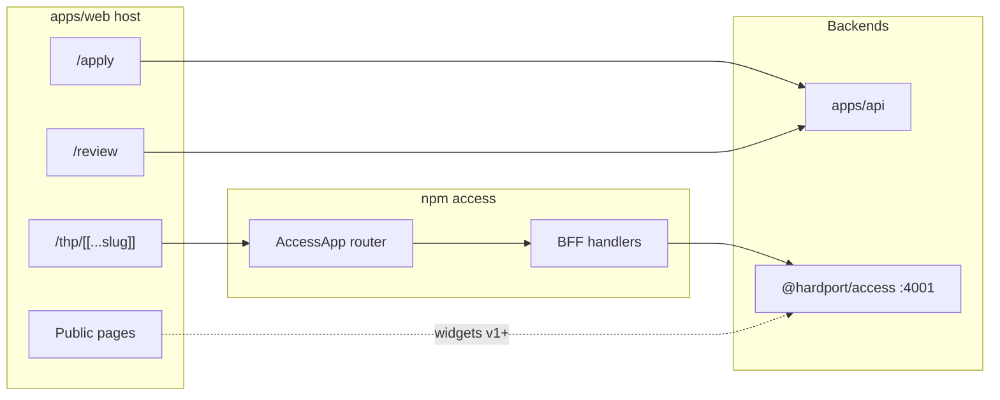

# Website sitemap — thehardport.com (confirmed)

Canonical page map for **`apps/web`**, the installable **`access`** console package, and what stays on **`apps/api`**.

**Related:** [`hardport-architecture.md`](hardport-architecture.md), [`thp-access-and-sign-in-roadmap.md`](thp-access-and-sign-in-roadmap.md), [`platform-routes.md`](platform-routes.md), [`access-installation-and-separation.md`](access-installation-and-separation.md) (external install + client/server split).

---

## Zones

| Zone | URL prefix | Backend | Package |
|------|------------|---------|---------|
| Public marketing | `/`, `/work-with-us`, … | Optional widgets → Access `pk` | Host Next app + optional `access` widget exports |
| Applicant intake | `/apply` | `apps/api` intake | Host Next app |
| **Application review (consulting)** | `/sign-in`, `/review` | `apps/api` + website DB | Host Next app only — **not** in `access` |
| Auth plumbing | `/auth/*` | `apps/api` OAuth | Host Next app |
| **Access console** | **`/thp/*`** | Access (+ Payments) via BFF | **`@psyferblock/access`** npm package |

---

## Public pages (live)

| Route | Indexed | Notes |
|-------|---------|--------|
| `/` | yes | Homepage ladder |
| `/work-with-us` | yes | Service explanation |
| `/business-levels` | yes | Maturity ladder |
| `/about` | yes | Who we are |
| `/apply` | yes | Engagement Readiness form |
| `/apply/submitted` | noindex | Post-submit |
| `/privacy` | yes | Legal |
| `/terms` | yes | Legal |

**Chrome:** marketing `SiteHeader` / `SiteFooter`. Footer link policy TBD (may add Access-related link or optional footer snippet from `access` package later).

**Widgets (v1+):** embeddable exports from `access` on any public page (keyword/unlock/checkout) — not separate top-level routes required.

---

## Application review — website-specific (live, outside `access`)

THP **consulting intake**: submitted applications live in the **website Postgres**, not the platform Access DB.

| Route | Auth | Purpose |
|-------|------|---------|
| `/sign-in` | — | Google/Meta OAuth start |
| `/auth/callback` | JWT handoff | Stores `thp_access_token` |
| `/auth/error` | — | OAuth failure |
| `/review` | JWT | List applications |
| `/review/[id]` | JWT | One application + pipeline form |

**Audience:** operators (`reviewer` / `admin` on website `users`).

**Discovery:** footer “Team sign-in” → `/sign-in` (for now).

May move under another path or product later; **does not** ship inside the `access` npm package.

---

## Access console — `/thp/*` (planned, via `access` package)

Install on any customer site:

```tsx
// app/thp/[[...slug]]/page.tsx
import { AccessApp } from '@psyferblock/access'

export default function ThpMountPage() {
  return <AccessApp basePath="/thp" />
}
```

```tsx
// app/thp/api/[...path]/route.ts — re-export BFF from package (exact API TBD)
export { handler as GET, handler as POST } from 'access/server'
```

The **`access`** package owns **internal client routes**, staff/partner UI, and BFF handlers. The host only mounts one page (+ API catch-all).

**Naming:** npm **`@psyferblock/access`** (UI). Not the same as **`@hardport/access`** (hosted API in `services/access`, port 4001).

### v1 routes (inside `AccessApp`)

| Internal path | Audience | Function |
|---------------|----------|----------|
| `/thp` | Staff | Dashboard / shell |
| `/thp/login` | Staff | Email + password + TOTP (BFF → Access) |
| `/thp/connection` | Staff | Env keys, verify link to Access |
| `/thp/partners` | Staff | Create/list partners (email, commission, campaigns) |
| `/thp/content` | Staff | Catalogue CRUD |
| `/thp/partner` | Partner | Email + partnership code → OTP |
| `/thp/partner/dashboard` | Partner | Stats, campaigns, commissions |
| `/thp/billing` | Staff | Plans / upgrades stub |

### v2 (deferred)

| Internal path | Function |
|---------------|----------|
| `/thp/keywords` | Keyword ↔ content ↔ campaign admin |
| `/thp/analytics` | Aggregates, keyword misses, reporting |

**Chrome:** console layout from `access` — **no** marketing header/footer. `robots: noindex`. Tracking off (same class as `/review`).

**Env (host site):**

```env
HP_ACCESS_URL=https://access.thehardport.com
NEXT_PUBLIC_HP_PUBLIC_KEY=pk_…
HP_SECRET_KEY=sk_…
```

---

## Future (not v1)

| Route | Notes |
|-------|--------|
| `/learn/*`, `/courses/*` | Website API + `CourseGrant` (Phase E in roadmap) |

---

## Diagram


